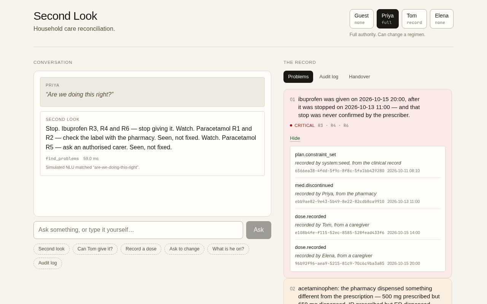
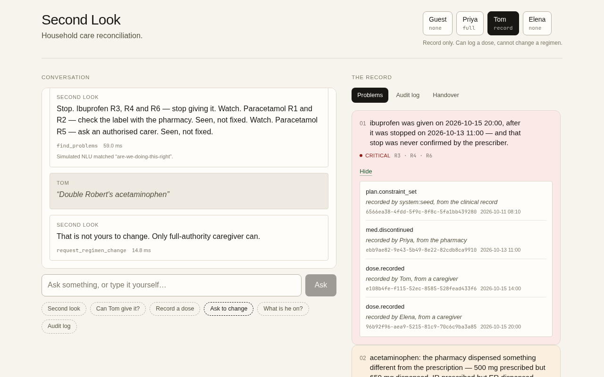
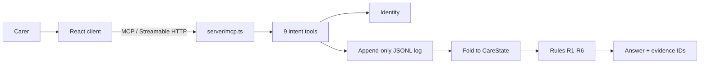

# Second Look

<p align="center">
  <strong>An evidence-first care record for households coordinating medication.</strong><br />
  Second Look is an MCP server and browser client that reconciles doses, plan changes, and authority across carers. Every answer names the events behind it.
</p>

<p align="center">
  <code>npm ci &amp;&amp; npm start</code> then open <a href="http://127.0.0.1:8787">127.0.0.1:8787</a>
</p>

<p align="center">
  <a href="LICENSE"></a>
  
  
  
</p>

<p align="center">
  <a href="https://divyanshu-kumar14.github.io/SecondLook/video/">Demo video</a> ·
  <a href="#quick-start">Quick start</a> ·
  <a href="#how-it-works">How it works</a> ·
  <a href="#mcp-tools">MCP tools</a> ·
  <a href="#optional-aws-anchor">AWS anchor</a> ·
  <a href="#documentation">Documentation</a>
</p>



> [!NOTE]
> Not a medical device. Every person, medication, and event is synthetic. The base demo needs no AWS account; the S3 Object Lock anchor is an optional operator workflow.

## Overview

Second Look is built for the Alexa+ track as a self-hosted MCP server on spec `2025-11-25` over Streamable HTTP. It has nine tools, one per customer intent, and every result carries the event IDs that support it.

A household caring for someone often has pharmacy labels, discharge notes, and a paper chart that do not agree. Several people record what was given. When a dose is missed or duplicated, the record cannot easily answer who gave what, under which authority, or whether the plan allowed it.

Second Look keeps an append-only record, applies six rules derived from the care plan, and reports where the plan and the record diverge. Empty results say what was empty. A refused change is written to the audit log and becomes a pending request for someone with authority.

## Quick start

### Prerequisites

- Node.js 22 or newer
- npm

### Run

```bash
npm ci
npm start
```

Open <http://127.0.0.1:8787>. `npm ci` installs dependencies and builds the client; `npm start` seeds a deterministic 19-event log.

Check readiness:

```bash
curl -s http://127.0.0.1:8787/healthz
# {"ok":true,"sessions":0}
```

The base demo needs no environment variables, API keys, database, or AWS credentials. Configuration is optional and covered below.

## Demo

The client has four demo beats. Each button makes a real MCP tool call; none of them reads the log or the fold directly.

| Step | Action | What to watch |
| --- | --- | --- |
| 1 | Open **Problems** | Three findings resolve in severity order: one critical and two high. |
| 2 | Switch to **Tom**, then **Ask to change** | The request is refused, the refusal is logged, and a pending request appears for a carer with authority. |
| 3 | Switch to **Priya**, open **Handover**, and approve | The decision is logged and the pending item leaves the queue. |
| 4 | Ask **Can Tom give it?** | The answer is no, with the evidence and the rule that produced it. |

Other controls are **Record a dose**, **What is he on?**, and **Audit log**. The right column also shows the negotiated protocol version and call latency.



### Demo personas

| Persona | Role | Can |
| --- | --- | --- |
| Priya | `full` | Change a regimen |
| Tom | `record` | Log a dose, cannot change a regimen |
| Elena | `none` | Read only |
| Guest | `none` | Read only |

The tokens are `demo-priya`, `demo-tom`, and `demo-elena`. They are public fixture values, not secrets. An absent or malformed `Authorization` header resolves to Guest.

## Design choices

- **Evidence travels with the answer.** A finding names the event IDs it came from, and the drawer opens the exact records with the actor and timestamp.
- **Authority is explicit.** A carer with `record` can log a dose. Only `full` can change a regimen. A refused change is a result with a pending request, not an error state.
- **The demo is deterministic.** `npm start` re-seeds the same 19 events on every boot. Finding IDs are stable, so acknowledging a finding does not create a new one on the next run.
- **Integrity is inspectable.** The log is SHA-256 hash-chained. The optional S3 anchor gives the audit record an external WORM copy.

## How it works



One process serves the MCP endpoint at `POST|GET|DELETE /mcp` and the built client at `/`. The browser is a real MCP client using the official SDK. It does not read the log or the fold itself, so every rendered answer came back through a tool call.

## MCP tools

| Tool | Intent |
| --- | --- |
| `check_dose` | Check whether a dose is consistent with the recorded plan. Does not record. |
| `record_dose` | Record a dose that has already been given. Never blocked. |
| `request_regimen_change` | Request a plan change. Refused below full authority; leaves a pending request. |
| `resolve_request` | Approve or decline a pending change. Requires full authority. |
| `get_current_regimen` | Return the current plan with dose, frequency, and provenance. |
| `find_problems` | Return all rule hits, grouped and ranked by severity. |
| `explain_problem` | Explain the rule and evidence behind a finding. |
| `get_timeline` | Return recorded events, filterable. Doubles as the audit log. |
| `get_handoff` | Return situation, background, assessment, recommendation, open items, and pending approvals. |

`check_dose` answers a consistency question against constraints in the recorded plan. It is not a dosage recommendation and not medical advice. The constraints come from the prescriber's record; a human prescriber remains the only source of a plan change.

## The scenario

Robert Alvarez, 74, has a hip replacement, hypertension, and CKD stage 3. His plan bars NSAIDs. His discharge paperwork prescribes ibuprofen anyway. Three days later, a pharmacist's phone call, not the prescriber, stops it. On day five it is given twice, once by a carer with no authority at all.

The engine finds all three unresolved problems:

| Finding | Rules | Severity |
| --- | --- | --- |
| Ibuprofen given after it was stopped, and the stop was never prescriber-confirmed | R3, R4, R6 | critical |
| Pharmacy dispensed 650 mg ER against a prescribed 500 mg IR; doses only 4 h apart | R1, R2 | high |
| A carer with role `none` asked to change the regimen | R5 | high |

The refusal path is deliberate. A carer without authority sees who can approve the change, the refusal is attributed to the token's identity rather than an argument supplied by the client, and the pending request is visible in the handover.

## Integrity

The log is append-only and SHA-256 hash-chained. There is no update and no delete in the write API. Corrections are new superseding events.

`npm run verify-log` exits 0 on the seeded log and exits 1 with the event number when a field is edited or an unknown key is injected. The verifier hashes what `JSON.parse` produced, not a schema projection that might strip fields before hashing.

The chain makes edits detectable; it does not prove authorship. A writer who can rewrite the whole file can recompute every hash. The optional S3 anchor below addresses the external-copy problem, not the signature problem.

## Optional AWS anchor

The base demo makes no AWS calls. This operator workflow stores the verified log and a manifest in Amazon S3 with Object Lock, so a local rewrite cannot silently rewrite the external record. It is the project's AWS Builder integration.

### Setup

Object Lock can only be enabled when the bucket is created. This example uses `ap-southeast-2`:

```bash
aws s3api create-bucket \
  --bucket <bucket> \
  --region ap-southeast-2 \
  --create-bucket-configuration LocationConstraint=ap-southeast-2 \
  --object-lock-enabled-for-bucket
```

The anchor sets retention on each object explicitly. A default retention rule is optional:

```bash
aws s3api put-object-lock-configuration \
  --bucket <bucket> \
  --object-lock-configuration '{"ObjectLockEnabled":"Enabled","Rule":{"DefaultRetention":{"Mode":"GOVERNANCE","Days":30}}}'
```

<details>
<summary>IAM policy</summary>

```json
{
  "Version": "2012-10-17",
  "Statement": [
    {
      "Sid": "ReadLockConfiguration",
      "Effect": "Allow",
      "Action": [
        "s3:GetBucketVersioning",
        "s3:GetBucketObjectLockConfiguration"
      ],
      "Resource": "arn:aws:s3:::<bucket>"
    },
    {
      "Sid": "WriteAndVerifyAnchors",
      "Effect": "Allow",
      "Action": [
        "s3:PutObject",
        "s3:PutObjectRetention",
        "s3:GetObject",
        "s3:GetObjectVersion",
        "s3:GetObjectRetention"
      ],
      "Resource": "arn:aws:s3:::<bucket>/anchors/*"
    }
  ]
}
```

</details>

### Anchor and verify

```bash
npm run seed
SL_ANCHOR_BUCKET=<bucket> SL_ANCHOR_REGION=ap-southeast-2 npm run anchor
npm run verify-anchor
```

`npm run anchor` verifies the local hash chain before uploading. It stores the exact `events.jsonl` bytes and a manifest containing the event count, head hash, file SHA-256, byte count, and retention. The local receipt at `.data/anchors.jsonl` records the S3 version IDs.

`npm run verify-anchor` fetches those exact versions and checks the anchored chain, manifest digest, retention, and the local log prefix. New events appended after the anchor are allowed. A changed or truncated prefix fails.

A dry run needs no AWS credentials:

```bash
npm run anchor -- --dry-run --bucket example-bucket
```

A live run against an Object Lock bucket in `ap-southeast-2` anchored 19 events under `GOVERNANCE` retention and passed all 15 verifier checks.

Object Lock provides write-once-read-many (WORM) retention. `GOVERNANCE` retention can still be bypassed by a principal with `s3:BypassGovernanceRetention`; the anchor policy does not grant it. The local receipt is unsigned, so the anchor is an external immutable copy and a tamper-detection aid, not a cryptographic signature or proof of authorship. See [`specs/SECURITY-REVIEW.md`](specs/SECURITY-REVIEW.md) for the threat model.

## Verification

| Gate | Command | Result |
| --- | --- | --- |
| Typecheck and lint | `npm run typecheck` and `npm run lint` | pass |
| Tests | `npm run test:coverage` | 15 files, 244 tests pass |
| Coverage | `npm run test:coverage` | 96.81% lines (334/345) |
| Protocol | `npm run verify-protocol` | 17/17 checks pass |
| Build | `npm run build` | pass, with a Vite chunk-size warning |
| Log | `npm run verify-log` | 19 events, chain intact |
| Supply chain | `npm audit` | 0 vulnerabilities |

`npm run verify` runs typecheck, lint, tests, and the coverage gate in one command. The UI check is opt-in because it needs a Chromium binary:

```bash
npm run verify-ui
```

The seeded log hashes to `0dc4f804d7c5d9b0...` on every boot.

<details>
<summary>Benchmarks</summary>

`npm run bench` runs 300 iterations on the 19-event demo log and 100 on a 500-event log.

| Measurement | p50 | p95 | Budget |
| --- | --- | --- | --- |
| `find_problems` (rules only) | 0.06 ms | 0.13 ms | 150 ms |
| `find_problems` (full tool path) | 0.10 ms | 0.19 ms | 150 ms |
| `check_dose` (projects a dose) | 0.08 ms | 0.12 ms | 150 ms |
| `find_problems` on 500 events | 16.41 ms | 22.11 ms | 50 ms |
| Cold fold on 500 events | 0.02 ms | 0.02 ms | 25 ms |

</details>

## Configuration

Nothing is required for the base demo. Every variable has a working default.

| Variable | Required | Default | Purpose |
| --- | --- | --- | --- |
| `HOST` | No | `127.0.0.1` | Interface to bind |
| `PORT` | No | `8787` | Port to bind |
| `SL_CLIENT_DIR` | No | `dist/client` | Built client to serve |
| `SL_LOG_FILE` | No | `.data/events.jsonl` | Append-only JSONL log path |
| `SL_LOG_MODE` | No | `demo` | `demo` truncates and re-seeds on boot; `persist` appends |
| `SL_ALLOWED_HOSTS` | No | none | Extra trusted `Host` values, comma-separated |
| `SL_ALLOWED_ORIGINS` | No | none | Extra trusted `Origin` values, comma-separated |
| `SL_MCP_JSON_RESPONSE` | No | `0` | `1` selects plain JSON instead of SSE |
| `SL_ANCHOR_BUCKET` | Only for `npm run anchor` | none | S3 bucket with Object Lock enabled |
| `SL_ANCHOR_REGION` | No | `AWS_REGION` or `us-east-1` | Region for the anchor bucket |
| `SL_ANCHOR_PREFIX` | No | `anchors` | S3 key prefix |
| `SL_ANCHOR_RETENTION_DAYS` | No | `30` | Object Lock retention, 1 to 3650 days |
| `SL_ANCHOR_RETENTION_MODE` | No | `GOVERNANCE` | `GOVERNANCE` or `COMPLIANCE` |
| `SL_ANCHOR_RECEIPT` | No | `.data/anchors.jsonl` | Local receipt file |

The `SL_ANCHOR_*` variables are read only by `npm run anchor` and `npm run verify-anchor`. `npm start` never touches AWS.

There are no secrets or credentials in this project. The demo personas are non-secret fixture values. The optional anchor uses the standard AWS credential chain and never reads credentials from the repository.

## Development

```bash
npm run dev              # server on 8787 and Vite on 5173
npm run verify           # typecheck, lint, tests, coverage
npm run verify-protocol  # PRD section 9; needs a running server
npm run verify-log       # hash-chain check
npm run verify-ui        # real browser check; needs Chromium
npm run bench            # latency budgets
npm run seed             # deterministic 19-event log
npm run anchor           # optional S3 upload
npm run verify-anchor    # verify the latest anchored copy
```

`npm run dev` and `npm start` both want port 8787, so do not run them at the same time.

## Tech stack

| Layer | Choice |
| --- | --- |
| Language | TypeScript 5.9.3, Node.js 22+ |
| Protocol | `@modelcontextprotocol/sdk` 1.32.1 |
| Validation | Zod 4.6.7 |
| HTTP | Express 5.3.0 |
| Client | React 19, Vite 8, Tailwind CSS 4, Motion 14 |
| Storage | Append-only JSONL on disk |
| AWS (optional) | `@aws-sdk/client-s3` 3.1154.0 with Amazon S3 Object Lock |

## Project structure

```text
server/     MCP transport, tools, rules, fold, log, anchor
client/     React MCP client
scripts/    seed, verification, anchor, benchmark, UI check
tests/      Vitest suites
specs/      PRD, implementation plan, security review
docs/       submission and screenshots
```

## Deployment

A [`Dockerfile`](Dockerfile) builds on `node:22-bookworm-slim` and serves the app on port `8787`. The client build pulls prebuilt glibc binaries, so the image uses Debian rather than Alpine. The image is built locally, not in CI, and its base tag is not digest-pinned.

## Production notes

The server deliberately ships without OAuth. A real Alexa+ add-on would need OAuth 2.1 authorization-code with PKCE (S256), the `resource` parameter set to the server's canonical URI, protected-resource metadata at `/.well-known/oauth-protected-resource` (RFC 9728), authorization-server metadata at `/.well-known/oauth-authorization-server` (RFC 8414), and a reachable remote URL with sub-500 ms round trips. An unauthenticated request must return 401 without `WWW-Authenticate`; the platform lists that header as not supported yet. None of this is simulated here.

## Limits

- The demo has no authentication. Persona tokens are public and labelled; a real deployment would take identity from the host platform.
- Utterance routing and spoken phrasing are simulated. Alexa+ supplies its own language layer.
- The log is plaintext JSONL. A real deployment needs encryption at rest, and append-only sits in tension with a deletion policy.
- The hash chain detects edits, not authorship. A wholesale rewrite by someone who can rewrite the file is outside what it proves.
- The S3 anchor is optional, anchors a prefix rather than the live tail, and keeps an unsigned local receipt.
- `verify-ui` is opt-in and needs a browser. It is not part of the default gate.

## Documentation

- [`docs/SUBMISSION.md`](docs/SUBMISSION.md): Devpost description and the judging-criteria map.
- [`specs/SECOND-LOOK-PRD.md`](specs/SECOND-LOOK-PRD.md): requirements and scope.
- [`specs/SECOND-LOOK-IMPLEMENTATION-PLAN.md`](specs/SECOND-LOOK-IMPLEMENTATION-PLAN.md): build plan and phase evidence.
- [`specs/SECURITY-REVIEW.md`](specs/SECURITY-REVIEW.md): authority surface, probes, and limits.
- [`DECISIONS.md`](DECISIONS.md): decision records with reasoning.
- [`DESIGN.md`](DESIGN.md): interface direction, palette, motion, and voice.
- [`FRICTION_LOG.md`](FRICTION_LOG.md): 38 things that went wrong and what each cost.

## License

MIT. See [`LICENSE`](LICENSE). Copyright (c) 2026 Divyanshu. All data in this repository is synthetic.
