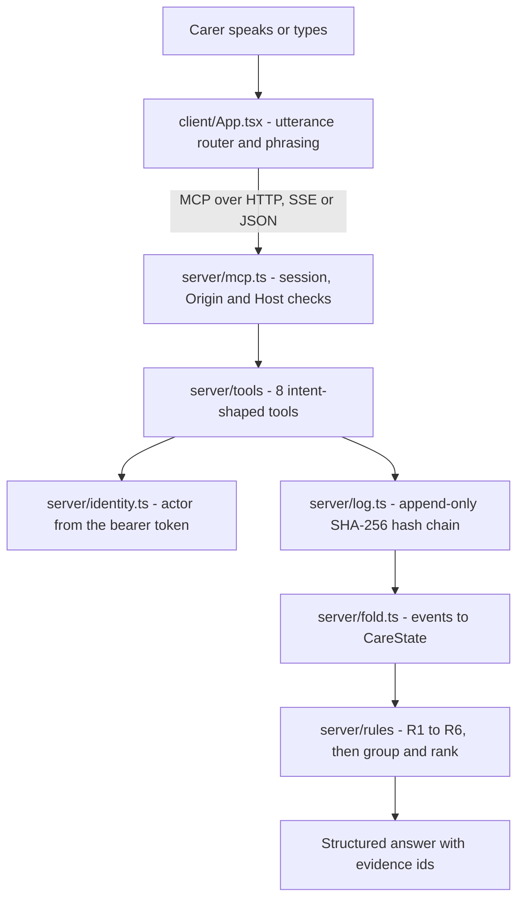

# Second Look — household care reconciliation for Alexa+

**TypeScript** · Node 22+ · MCP server + browser client · MIT

When a household cares for someone across several carers and several sets of
paperwork that never agree, Second Look answers three questions from an
append-only record — *is this dose safe to give right now*, *are we doing this
right*, and *what still needs a human* — and shows the evidence for every answer.

## Run it

```bash
npm install && npm start
```

Then open **<http://127.0.0.1:8787>**. No environment variables, no API keys, no
database, no external services. Check it is alive:

```bash
curl -s http://127.0.0.1:8787/healthz
npm run verify-log
```

> **Not a medical device. All data is synthetic.** Every person, medication and
> event is generated in code by `npm run seed`. Nothing here is clinical advice:
> the system enforces constraints that arrive in the care record, it does not
> decide what is medically correct on its own.

## The problem

A household caring for someone with several medications has paperwork from a
pharmacy and a hospital that do not agree, and more than one person recording
what was given. When something goes wrong, nobody can reconstruct what was
actually given, by whom, or whether it was safe to give — and the one artefact
that could answer, the dose record, is usually a paper chart in a drawer.

Reconciliation done properly means reading the whole record, applying the care
plan, and reporting what does not add up. Today that is manual, so it does not
happen at the moment it would help.

## What it does

Second Look keeps an **append-only, hash-chained** record of what was given, by
whom, under which authority, and applies six rules that encode the constraints a
care plan actually states. It exposes the result as **8 MCP tools**, each written
as one customer intent, so an assistant can select them from how a person
actually speaks.

Three properties do the real work:

- **Every answer carries its evidence.** A finding names the event ids it was
  derived from, and the UI can open them. Nothing is asserted without a record.
- **An empty result says what was empty.** There is no "all clear". Assurance is
  `NONE_FOUND_IN_RECORD` or `FINDINGS_PRESENT`, and every answer ships coverage
  beside it.
- **Recording is never blocked; changing is.** A dose that already happened must
  always be loggable by anyone. Only plan changes are refused.

## See it work in 60 seconds

Open <http://127.0.0.1:8787> and follow three beats. Each one is a button in the
client, and each one is a real MCP tool call — never the log or the fold.

1. **Second look** — asks *are we doing this right?* Three findings resolve in
   severity order: one critical, two high.
2. **Switch persona to Tom** (role `record`), then **Ask to change**. The request
   is refused, the refusal is written to the audit log, and a pending request is
   created for someone with authority.
3. **Can Tom give it?** — asks whether Tom may give ibuprofen right now. The
   answer is no, and it names the evidence.

Other buttons: **Record a dose**, **What is he on?**, **Audit log**. The right
column also holds the latency HUD and a protocol inspector showing the version
actually negotiated during the handshake.

## Key innovations

- **A deterministic fold with provenance** — [`server/fold.ts`](server/fold.ts)
  reduces the event log to a `CareState`, and every value it produces can name
  the event it came from. Superseded records are kept, not overwritten.
- **Stable finding identity** — [`server/finding-id.ts`](server/finding-id.ts)
  derives a finding's id from its content and its oldest supporting evidence, so
  acknowledging a finding does not make it reappear as a new one on the next
  run. This is what makes a recorded demo repeatable.
- **A refusal that is a result, not an error** — [`server/authority.ts`](server/authority.ts)
  plus the tool handlers. A refusal returns a structured, renderable answer *and*
  leaves an audit trail *and* creates a pending request.
- **A verifier that checks bytes, not schema output** —
  [`server/log.ts`](server/log.ts). See [Integrity](#integrity) for the bug this
  caught.

## Architecture



One process serves both the MCP endpoint (`POST|GET|DELETE /mcp`) and the built
client. The client is a *real* MCP client using the official SDK — it never reads
the log or the fold, so every word rendered on screen came back from a tool.

## The eight tools

| Tool | Intent |
| --- | --- |
| `check_dose` | Is it safe to give this dose right now? Does not record. |
| `record_dose` | Record that a dose has already been given. Never refused. |
| `request_regimen_change` | Ask to change how a medication is given. The only refused tool. |
| `get_current_regimen` | What is currently recorded, with dose, frequency and provenance. |
| `find_problems` | Are we doing this right? All rule hits, grouped and ranked. |
| `explain_problem` | Which rule raised this, and the evidence behind it. |
| `get_timeline` | What was recorded and when. Filterable — the audit log. |
| `get_handoff` | Situation, background, assessment, recommendation, and what is still open. |

## The scenario

Robert Alvarez, 74, hip replacement, hypertension and CKD stage 3. NSAIDs are
barred by his plan. His discharge paperwork prescribes ibuprofen anyway. Three
days later a pharmacist's phone call — not the prescriber — stops it. On day five
it is given twice, once by a carer with no authority at all.

That yields three unresolved problems, and the engine finds all of them:

| Finding | Rules | Severity |
| --- | --- | --- |
| Ibuprofen given after it was stopped — and the stop was never prescriber-confirmed | R3, R4, R6 | critical |
| Pharmacy dispensed 650 mg ER against a prescribed 500 mg IR; doses only 4 h apart | R1, R2 | high |
| A carer with role `none` asked to change the regimen | R5 | high |

### How it refuses, and how it does not

Recording a dose is **never blocked**. A real dose that happened must always be
loggable, so `record_dose` accepts and flags rather than refuses.

Only **plan changes** are refused, and a refusal is a **successful result** — the
caller renders it, and the log records it. That refusal is only credible because
identity is resolved server-side. No tool accepts an `actorId` that establishes
who is acting; the actor is stamped at write time from the bearer token. Verified
by probe, not by assertion:

``` text
demo-tom (role: record)                      status=refused  pending=req-caregiver-tom-…
demo-tom + INJECTED actorId and role         status=refused  pending=req-caregiver-tom-…
demo-priya (role: full)                      status=applied
no Authorization header (guest)              status=refused  pending=req-guest-…
garbage token                                status=refused  pending=req-guest-…
```

The second row is the one that matters. The request claimed full privilege in its
arguments and was still refused, and the pending request was attributed to the
token's identity rather than the one the client asserted.

## What we simulate, and what a real add-on would need

**Simulated here.** Utterance routing and spoken phrasing are deterministic
templates, labelled as *Simulated* in the UI — Alexa+ generates its own. The
server has no OAuth: identity is three static, non-secret, deliberately-labelled
demo personas, and an absent or malformed token degrades to a guest with role
`none`. We publish **no** authorization-server metadata, because advertising
authentication we do not enforce would mislead clients.

| Persona | Token | Role | Can |
| --- | --- | --- | --- |
| Priya | `demo-priya` | `full` | Change a regimen |
| Tom | `demo-tom` | `record` | Log a dose, cannot change a regimen |
| Elena | `demo-elena` | `none` | Read only |
| *(no header)* | — | `none` | Read only |

**A real Alexa+ add-on would need** OAuth 2.1 authorization-code with PKCE (S256),
the `resource` parameter set to the server's canonical URI, auth-server metadata
at `/.well-known/oauth-authorization-server`, a 401 carrying `WWW-Authenticate`
for unauthenticated requests, and a reachable remote URL with sub-500 ms round
trips. None of that is simulated here.

**Out of scope for an MCP server:** the shared-speaker problem. If two people use
one Echo, the server cannot tell them apart. That is a voice-profile concern, not
something this protocol exposes — we say so rather than pretend to solve it.

## Why the demo repeats exactly

A demo that changes between takes cannot be recorded twice. `npm start`
truncates and re-seeds a byte-identical log on every boot, so the first judge run
and the third recording see the same state:

```bash
npm run seed && sha256sum .data/events.jsonl
npm run seed && sha256sum .data/events.jsonl
```

``` text
0dc4f804d7c5d9b0dd5bab9c01d7543fc847357c9955f50a44f85e98749ce17f
0dc4f804d7c5d9b0dd5bab9c01d7543fc847357c9955f50a44f85e98749ce17f
```

## Integrity

The log is append-only and SHA-256 hash-chained. There is no update and no delete
in the write API; corrections are new superseding events. Three tamper cases, run
against a log seeded by a clean clone:

``` text
$ npm run verify-log                                   # untouched
[verify-log] OK — 19 events, chain intact.              exit 0

$ # edit a field the schema knows
$ npm run verify-log
[verify-log] TAMPERED — chain breaks at event 5 of 19.
             reason: hash mismatch at event 5: expected b33f057e5fa4…, got f78a8fccf0dd…
                                                         exit 1

$ # inject fields the schema does not know
$ npm run verify-log
[verify-log] TAMPERED — chain breaks at event 5 of 19.
             reason: unexpected field(s) not in EventSchema: notes, extra —
                     the stored record is not the record that was hashed
                                                         exit 1

$ # reorder keys, change nothing else
$ npm run verify-log
[verify-log] OK — 19 events, chain intact.              exit 0
```

The second case used to **pass**. `#load()` ran every line through `EventSchema`,
a Zod object, which strips unknown keys — so an injected field was discarded
before hashing and the chain never saw it. The verifier now hashes what
`JSON.parse` produced. Found by running the tamper check rather than assuming it
had been run before; recorded as **F30** / **D25**.

Editing one field is detected and located. It is still editable on disk — the
chain makes tampering **detectable**, not impossible, and we do not claim
otherwise. It also does not stop anyone who can rewrite the whole file from
recomputing every hash: a chain with no signature attests to integrity, not to
authorship.

## Evidence

Everything below was produced by running the commands on a clean clone of this
repository with no environment variables set.

### Clean install and cold start

``` text
$ npm install
added 290 packages in 8s

$ env -i npm start        # strips the entire environment
[second-look] listening on http://127.0.0.1:8787
[second-look]   MCP endpoint : POST|GET|DELETE http://127.0.0.1:8787/mcp
[second-look]   client       : http://127.0.0.1:8787/
[second-look]   log mode     : demo — seeded 19 events, sha256 0dc4f804d7c5d9b0…
```

Cold start to listening: **0.58 s** against an 8 s budget.

A production-only install — 100 packages against 290 for the full dev tree, the
same dependency set the Docker runtime stage uses — boots, seeds the same 19
events with the same hash, and answers `find_problems` with the same three
findings. No server module imports a dev dependency at runtime.

A [`Dockerfile`](Dockerfile) is included. It is **Debian-based, not Alpine**: the
client build pulls two prebuilt glibc binaries and Alpine's musl would fail to
load them (**D24**). The image was not built here — the build machine's Docker
socket is `root:docker` and adding the group needs `sudo`. What was verified is
the part that would actually fail: the clean-clone path and the production-only
runtime, both end to end.

### Protocol conformance (PRD §9)

``` text
$ npm run verify-protocol     # server must be running
  §9.1 initialize / initialized / session id           ✅
  §9.2 response mode: SSE and application/json         ✅
  §9.3 tools/list carries full JSON Schema             ✅
  §9.4 session id enforced on later requests           ✅
  §9.5 MCP-Protocol-Version negotiated; invalid → 400  ✅
  §9.6 Origin validated on every connection            ✅
  §9.7 binds 127.0.0.1 by default                      ✅
  §9.8 GET → 405, DELETE terminates the session         ✅
  §9.9 JSON-RPC over UTF-8, one message per response   ✅
──────────────────────────────────────────
  passed: 17   failed: 0
──────────────────────────────────────────
```

### Tests and coverage

``` text
$ npm run verify
  Test Files  13 passed (13)
       Tests  205 passed (205)
Lines        : 94.81% ( 311/328 )
```

Coverage is scoped to the rules engine, the fold, the log and the authority
model — the four places where a defect would be a safety problem. Current:
**94.8 %** overall, **100 %** on `server/authority.ts` and on every rule.

### Latency

``` text
$ npm run bench
  find_problems (rules only)        p50  0.06 ms   p95  0.13 ms   budget 150 ms   PASS
  find_problems (full tool path)    p50  0.10 ms   p95  0.19 ms   budget 150 ms   PASS
  check_dose (projects a dose)      p50  0.08 ms   p95  0.12 ms   budget 150 ms   PASS
  find_problems on 500 events       p50 16.41 ms   p95 22.11 ms   budget  50 ms   PASS
  cold fold on 500 events           p50  0.02 ms   p95  0.02 ms   budget  25 ms   PASS
```

### Supply chain

``` text
$ npm audit
found 0 vulnerabilities
```

## Configuration

Nothing is required. Every variable has a working default — that is the point.

| Variable | Required | Default | Purpose |
| --- | --- | --- | --- |
| `HOST` | No | `127.0.0.1` | Interface to bind |
| `PORT` | No | `8787` | Port to bind |
| `SL_CLIENT_DIR` | No | `dist/client` | Built client to serve |
| `SL_LOG_FILE` | No | `.data/events.jsonl` | Append-only JSONL log path |
| `SL_LOG_MODE` | No | `demo` | `demo` truncates and re-seeds on boot; `persist` appends |
| `SL_ALLOWED_HOSTS` | No | — | Extra trusted `Host` values, comma-separated |
| `SL_ALLOWED_ORIGINS` | No | — | Extra trusted `Origin` values, comma-separated |
| `SL_MCP_JSON_RESPONSE` | No | `0` | `1` selects plain JSON instead of SSE (see [D22](DECISIONS.md)) |

There are no secrets, keys or credentials in this project. The demo personas are
non-secret fixture values, deliberately labelled rather than hidden.

### A note on dependencies

`find node_modules -name '*.node'` returns two files, from Vite's bundler and CSS
minifier. Both are **prebuilt platform binaries** shipped as optional
dependencies — nothing compiles from source and no toolchain is needed, which is
what matters for portability. We state it rather than claim a purity we do not
have. They are glibc builds, which is why the Docker image is Debian-based.

## Tech stack

| Layer | Choice | Why |
| --- | --- | --- |
| Language | TypeScript 5.9.3, Node 22+ | One language across server, client and scripts |
| Protocol | `@modelcontextprotocol/sdk` 1.32.1 | The server and the browser client both speak real MCP |
| Validation | Zod 4.6.7 | One schema drives both TypeScript types and the emitted JSON Schema |
| HTTP | Express 5.3.0 | `Origin` and `Host` checks run in front of the MCP transport |
| Client | React 19, Vite 8 | The demo client is a real MCP client, not a mock |
| Styling | Tailwind CSS 4 | Tokens in `@theme`; 4.65 kB gzipped |
| Motion | Motion 14 | One authored moment, `reducedMotion="user"` at the root |
| Store | Append-only JSONL on disk | No database, no migration, hash-chained |

## Development

```bash
npm run dev            # server on :8787 and Vite on :5173 — not both on 8787
npm run verify         # typecheck + lint + tests + coverage gate
npm run verify-protocol  # PRD §9 checklist; needs the server running
npm run verify-log       # hash chain; exits 1 if tampered
npm run bench            # latency budgets
npm run seed             # re-seed the deterministic log
scripts/transcript.sh    # replay the demo spine against a running server
```

`npm run dev` and `npm start` must not run at the same time — they both want
port 8787.

## Limitations

Stated plainly, because the demo is more useful when its edges are known.

- **Utterance routing and phrasing are simulated.** Alexa+ supplies its own.
- **The demo has no authentication.** Tokens are public and labelled, so on a real
  deployment this is an open system. Identity would come from the host platform.
- **The log is a plain JSONL file.** A real deployment needs encryption at rest,
  and append-only sits in direct tension with any deletion policy. Unresolved.
- **A hash chain is not a signature.** It detects edits, not a wholesale rewrite
  by someone who can rewrite the whole file.
- **Responsive layout below desktop is unverified**, and no human has reviewed the
  rebuilt interface.
- **The Docker image has not been built**, only its contents verified.

## Design records

We wrote down what happened, including the parts that went wrong.

- [`DECISIONS.md`](DECISIONS.md) — 26 decisions with reasoning, including the two
  the plan expected to fail and did not.
- [`FRICTION_LOG.md`](FRICTION_LOG.md) — 32 things that went wrong, what caused
  each, and what it cost.
- [`DESIGN.md`](DESIGN.md) — interface direction: palette, motion, and the rules
  that keep the actor as provenance rather than cause.
- [`specs/SECURITY-REVIEW.md`](specs/SECURITY-REVIEW.md) — the authority surface,
  probed, plus two limits we chose not to paper over.
- [`specs/PRODUCT-FEEDBACK.md`](specs/PRODUCT-FEEDBACK.md) — what we used every
  dependency for, and where each one bit.
- [`specs/advancements/`](specs/advancements/) — per-phase evidence.
- [`specs/SECOND-LOOK-PRD.md`](specs/SECOND-LOOK-PRD.md) and
  [`specs/SECOND-LOOK-IMPLEMENTATION-PLAN.md`](specs/SECOND-LOOK-IMPLEMENTATION-PLAN.md)
  — the requirements and the plan this was built against.

## License

MIT — see [`LICENSE`](LICENSE). Copyright (c) 2026 Divyanshu. 100% synthetic data;
no real patient information is present in this repository.
