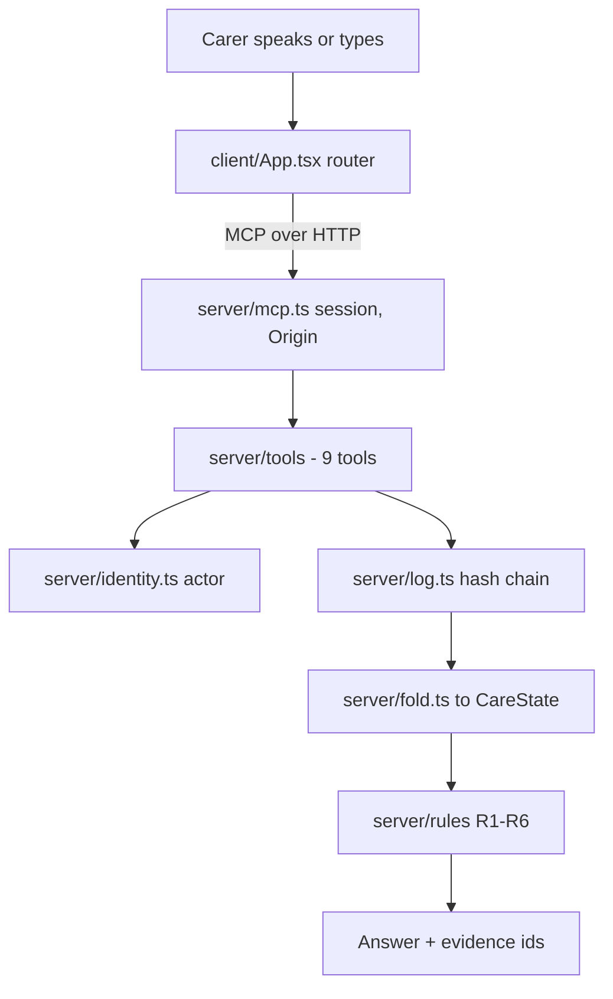

# Second Look — household care reconciliation for Alexa+

TypeScript, Node 22+, an MCP server and a browser client, MIT.

Built for the Alexa+ track as a self-hosted MCP server on spec `2025-11-25`
over Streamable HTTP. It has 9 tools, one per customer intent, and every answer
names the event ids behind it. The first commit is 2026-10-18, inside the
submission window.

When a household cares for someone across several carers and several sets of
paperwork that never agree, Second Look answers three questions from an
append-only record: is this dose safe to give right now, are we doing this
right, and what still needs a human. Every answer shows the evidence for it.

## Run it

```bash
npm install && npm start
```

Then open **<http://127.0.0.1:8787>**. No environment variables, API keys,
database, or external services. Check it is alive:

```bash
curl -s http://127.0.0.1:8787/healthz
npm run verify-log
```

> Not a medical device. All data is synthetic. Every person, medication and
> event is generated in code by `npm run seed`. Nothing here is clinical advice:
> the system enforces constraints that arrive in the care record; it does not
> decide what is medically correct on its own.


## The problem

A household caring for someone with several medications has paperwork from a
pharmacy and a hospital that do not agree, and more than one person recording
what was given. When something goes wrong, nobody can reconstruct what was
actually given, by whom, or whether it was safe. The one artefact that could
answer, the dose record, is usually a paper chart in a drawer.

Reconciliation done properly means reading the whole record, applying the care
plan, and reporting what does not add up. Today that is manual, so it does not
happen at the moment it would help.

## What it does

Second Look keeps an append-only, hash-chained record of what was given, by
whom, under which authority, and applies six rules that encode the constraints
a care plan actually states. It exposes the result as 9 MCP tools, each written
as one customer intent, so an assistant can select them from how a person
speaks.

Every answer carries its evidence. A finding names the event ids it was derived
from, and the UI can open them. Nothing is asserted without a record.

An empty result says what was empty. There is no "all clear". Assurance is
`NONE_FOUND_IN_RECORD` or `FINDINGS_PRESENT`, and every answer ships coverage
beside it.

Recording is never blocked; changing is. A dose that already happened must
always be loggable by anyone. Only plan changes are refused, and a refusal
leaves a pending request that an authorised carer can approve or decline.

## See it work in 60 seconds

Open <http://127.0.0.1:8787> and follow four beats. Each one is a button in the
client, and each button makes a real MCP tool call; none of them reads the log
or the fold directly.

1. **Second look** asks *are we doing this right?* Three findings resolve in
   severity order: one critical, two high.
2. **Switch persona to Tom** (role `record`), then **Ask to change**. The request
   is refused, the refusal is written to the audit log, and a pending request is
   created for someone with authority.
3. **Switch persona to Priya** (role `full`), open **Handover**, and **Approve**
   the request. The decision is written to the audit log, and the pending item
   disappears.
4. **Can Tom give it?** asks whether Tom may give ibuprofen right now. The
   answer is no, and it names the evidence.

Other buttons: **Record a dose**, **What is he on?**, **Audit log**. The right
column also holds the latency HUD and a protocol inspector showing the version
actually negotiated during the handshake.


## Key innovations

The fold in [`server/fold.ts`](server/fold.ts) reduces the event log to a
`CareState`, and every value it produces can name the event it came from.
Superseded records are kept, not overwritten.

Finding ids are stable. [`server/finding-id.ts`](server/finding-id.ts) derives
an id from the finding's content and its oldest supporting evidence, so
acknowledging a finding does not make it reappear as a new one on the next run.
That is what makes a recorded demo repeatable.

A refusal is a result. [`server/authority.ts`](server/authority.ts) and the tool
handlers return a structured, renderable answer, write an audit event, and
create a pending request.

[`server/log.ts`](server/log.ts) checks the bytes on disk, not the schema's
projection of them. See [Integrity](#integrity) for the bug this caught.

## Architecture



One process serves both the MCP endpoint (`POST|GET|DELETE /mcp`) and the built
client. The client is a real MCP client using the official SDK. It never reads
the log or the fold, so every word rendered on screen came back from a tool.

## The nine tools

| Tool | Intent |
| --- | --- |
| `check_dose` | Is giving this dose consistent with the care plan on record? Does not record. |
| `record_dose` | Record that a dose has already been given. Never refused. |
| `request_regimen_change` | Ask to change how a medication is given. Refused below full authority; leaves a pending request. |
| `resolve_request` | Approve or decline a pending request. Same authority as making one. |
| `get_current_regimen` | What is currently recorded, with dose, frequency and provenance. |
| `find_problems` | Are we doing this right? All rule hits, grouped and ranked. |
| `explain_problem` | Which rule raised this, and the evidence behind it. |
| `get_timeline` | What was recorded and when. Filterable, so it doubles as the audit log. |
| `get_handoff` | Situation, background, assessment, recommendation, what is still open, and what is waiting for approval. |

`check_dose` answers a consistency question against the constraints in the
recorded plan. It is not a dosage recommendation and not medical advice: the
constraints come from the prescriber's record, and a human prescriber remains
the only source of a plan change.

## The scenario

Robert Alvarez, 74, hip replacement, hypertension and CKD stage 3. NSAIDs are
barred by his plan. His discharge paperwork prescribes ibuprofen anyway. Three
days later a pharmacist's phone call, not the prescriber, stops it. On day five
it is given twice, once by a carer with no authority at all.

That yields three unresolved problems, and the engine finds all of them:

| Finding | Rules | Severity |
| --- | --- | --- |
| Ibuprofen given after it was stopped, and the stop was never prescriber-confirmed | R3, R4, R6 | critical |
| Pharmacy dispensed 650 mg ER against a prescribed 500 mg IR; doses only 4 h apart | R1, R2 | high |
| A carer with role `none` asked to change the regimen | R5 | high |

### How it refuses, and how it does not

Recording a dose is never blocked. A real dose that happened must always be
loggable, so `record_dose` accepts and flags rather than refuses.

Only plan changes are refused. A refusal is a successful result: the caller
renders it, and the log records it. That refusal is only credible because
identity is resolved server-side. No tool accepts an `actorId` that establishes
who is acting; the actor is stamped at write time from the bearer token. A probe
produced this table:

```text
demo-tom (role: record)          refused   -> caregiver-tom
demo-tom + INJECTED actor/role   refused   -> caregiver-tom
demo-priya (role: full)          applied
guest (no header)                refused   -> guest
garbage token                    refused   -> guest
```

The right-hand column is the pending request that was created, and who it was
attributed to. Switch to Priya and the **Handover** column offers it for
approval; either decision lands in the audit log, and the pending item
disappears once it is settled.

The injected row claimed full privilege in its arguments and was still refused.
The pending request was attributed to the token's identity, `caregiver-tom`, not
the one the client asserted.

## What we simulate, and what a real add-on would need

Utterance routing and spoken phrasing are deterministic templates, labelled as
*Simulated* in the UI; Alexa+ generates its own. The server has no OAuth:
identity is three static, non-secret, deliberately-labelled demo personas, and
an absent or malformed token degrades to a guest with role `none`. We publish no
authorization-server metadata, because advertising authentication we do not
enforce would mislead clients.

| Persona | Token | Role | Can |
| --- | --- | --- | --- |
| Priya | `demo-priya` | `full` | Change a regimen |
| Tom | `demo-tom` | `record` | Log a dose, cannot change a regimen |
| Elena | `demo-elena` | `none` | Read only |
| *(no header)* | none | `none` | Read only |

A real Alexa+ add-on would need OAuth 2.1 authorization-code with PKCE (S256),
the `resource` parameter set to the server's canonical URI, a Protected Resource
Metadata document (RFC 9728) at `/.well-known/oauth-protected-resource`,
auth-server metadata at `/.well-known/oauth-authorization-server`, and a
reachable remote URL with sub-500 ms round trips. One detail is easy to get
backwards: an unauthenticated request must return 401 without
`WWW-Authenticate`. The platform lists that header as *Not Supported Yet*, so
sending the challenge breaks the handshake instead of starting it. None of that
is simulated here.

Out of scope for an MCP server: the shared-speaker problem. If two people use
one Echo, the server cannot tell them apart. That is a voice-profile concern,
not something this protocol exposes.

## Why the demo repeats exactly

A demo that changes between takes cannot be recorded twice. `npm start`
truncates and re-seeds a byte-identical log on every boot, so the first judge
run and the third recording see the same state:

```bash
npm run seed && sha256sum .data/events.jsonl
npm run seed && sha256sum .data/events.jsonl
```

``` text
0dc4f804d7c5d9b0dd5bab9c01d7543fc847357c9955f50a44f85e98749ce17f
0dc4f804d7c5d9b0dd5bab9c01d7543fc847357c9955f50a44f85e98749ce17f
```

## Integrity

The log is append-only and SHA-256 hash-chained. There is no update and no
delete in the write API; corrections are new superseding events. Three tamper
cases, run against a log seeded by a clean clone:

```text
$ npm run verify-log                  # untouched
[verify-log] OK — 19 events, intact.   exit 0

$ npm run verify-log                  # edit a field it knows
[verify-log] TAMPERED — chain breaks at event 5 of 19.
             reason: hash mismatch at event 5     exit 1

$ npm run verify-log                  # inject unknown fields
[verify-log] TAMPERED — chain breaks at event 5 of 19.
             reason: unexpected field(s) not in
             EventSchema: notes, extra            exit 1

$ npm run verify-log                  # reorder keys only
[verify-log] OK — 19 events, intact.   exit 0
```

The second case used to pass. `#load()` ran every line through `EventSchema`, a
Zod object, which strips unknown keys, so an injected field was discarded before
hashing and the chain never saw it. The verifier now hashes what `JSON.parse`
produced. We found it by running the tamper check; recorded as **F30** / **D25**.

Editing one field is detected and located. The file is still editable on disk:
the chain makes tampering detectable, not impossible. It also does not stop
anyone who can rewrite the whole file from recomputing every hash. A chain with
no signature attests to integrity, not authorship.

For an external copy that survives a local rewrite, see the optional
[AWS integration](#aws-integration-s3-object-lock-audit-anchor) below.

## AWS integration: S3 Object Lock audit anchor

The base demo is zero-config and makes no AWS calls. This optional operator
command is the project's AWS Builder integration: it stores an immutable copy of
the audit log in Amazon S3, so a local rewrite cannot silently rewrite the
external record.

### One-time AWS setup

Object Lock can only be enabled when a bucket is created. Create a bucket in the
region you will use; this example uses `ap-southeast-2`:

```bash
aws s3api create-bucket \
  --bucket <bucket> \
  --region ap-southeast-2 \
  --create-bucket-configuration LocationConstraint=ap-southeast-2 \
  --object-lock-enabled-for-bucket
```

Optionally set a default retention rule. The anchor also sets retention on each
object explicitly:

```bash
aws s3api put-object-lock-configuration \
  --bucket <bucket> \
  --object-lock-configuration '{"ObjectLockEnabled":"Enabled","Rule":{"DefaultRetention":{"Mode":"GOVERNANCE","Days":30}}}'
```

The identity running the anchor needs these permissions, scoped to the bucket:

```json
{
  "Version": "2012-10-17",
  "Statement": [
    {
      "Sid": "ReadLockConfiguration",
      "Effect": "Allow",
      "Action": [
        "s3:GetBucketVersioning",
        "s3:GetBucketObjectLockConfiguration"
      ],
      "Resource": "arn:aws:s3:::<bucket>"
    },
    {
      "Sid": "WriteAndVerifyAnchors",
      "Effect": "Allow",
      "Action": [
        "s3:PutObject",
        "s3:PutObjectRetention",
        "s3:GetObject",
        "s3:GetObjectVersion",
        "s3:GetObjectRetention"
      ],
      "Resource": "arn:aws:s3:::<bucket>/anchors/*"
    }
  ]
}
```

### Anchor and verify

```bash
npm run seed
SL_ANCHOR_BUCKET=<bucket> SL_ANCHOR_REGION=ap-southeast-2 npm run anchor
npm run verify-anchor
```

`npm run anchor` verifies the local hash chain before it uploads anything. It
uploads the exact `events.jsonl` bytes and a manifest containing the event
count, head hash, file SHA-256 and retention, then appends a local receipt to
`.data/anchors.jsonl` with the S3 version IDs. `npm run verify-anchor` reads the
latest receipt, fetches those exact object versions, checks the anchored chain,
the manifest digest, the retention, and confirms that the local log still has
the same head at that event count. New events appended after the anchor are
allowed; a changed or truncated prefix fails.

Dry run, no AWS credentials needed:

```bash
npm run anchor -- --dry-run --bucket example-bucket
```

Options: `--prefix`, `--retention-days` (default 30), `--mode` (`GOVERNANCE` or
`COMPLIANCE`), `--log`, `--receipt`. Environment variables: `SL_ANCHOR_BUCKET`,
`SL_ANCHOR_REGION`, `SL_ANCHOR_PREFIX`, `SL_ANCHOR_RETENTION_DAYS`,
`SL_ANCHOR_RETENTION_MODE`, `SL_ANCHOR_RECEIPT`.

A live run against an Object Lock bucket in `ap-southeast-2` (bucket and
version IDs shortened):

```text
$ SL_ANCHOR_BUCKET=<bucket> SL_ANCHOR_REGION=ap-southeast-2 npm run anchor
[anchor] log: .data/events.jsonl (19 events, head b4d8e855d0a5…)
[anchor] s3://<bucket>/anchors/2026-10-20T22-52-02-781Z/events.jsonl (version c4z53Cr9…)
[anchor] s3://<bucket>/anchors/2026-10-20T22-52-02-781Z/manifest.json (version 8TqW3_Ohg…)
[anchor] receipt: .data/anchors.jsonl
[anchor] retention: GOVERNANCE until 2026-11-19T22:52:02.781Z

$ npm run verify-anchor
[verify-anchor] ok   manifest-sha256: the manifest bytes match the digest recorded in the local receipt
[verify-anchor] ok   anchored-log-sha256: anchored bytes match the manifest digest
[verify-anchor] ok   local-log-head: local prefix ends at the anchored head hash
[verify-anchor] ok   retention-manifest: GOVERNANCE until 2026-11-19T22:52:02.781Z
[verify-anchor] ok   retention-log: GOVERNANCE until 2026-11-19T22:52:02.781Z
[verify-anchor] PASS — anchored 19 events; local log has 19 (0 event(s) appended since the anchor).
```

The verifier runs 15 checks in total; the lines above are the last five. This run
is not part of `npm run verify`; it needs an operator identity with the policy
above.

### What the anchor proves, and what it does not

Object Lock gives the anchored objects WORM retention: they cannot be
overwritten or deleted before the retention date, even by a principal with write
access. `GOVERNANCE` retention can still be bypassed by a principal granted
`s3:BypassGovernanceRetention`; the anchor's policy does not grant it. Use
`COMPLIANCE` if the hold must not be shortened or removed by anyone. The
verifier's local receipt tells it which versions to fetch; the receipt itself is
a local, unsigned file. A privileged attacker who can rewrite the receipt and
upload different objects under new keys can point the verifier at a different
anchor. The anchor is an external, immutable copy and a tamper-detection aid,
not a cryptographic signature or a proof of authorship.

## Evidence

These were produced on a clean clone of this repository with no environment
variables set.

### Clean install and cold start

```text
$ npm ci
added 316 packages in 4s

$ env -i npm start        # strips the entire environment
[second-look] listening on http://127.0.0.1:8787
[second-look]   log mode     : demo — seeded 19 events
```

Cold start to listening: 0.58 s against an 8 s budget. The seed is
`sha256 0dc4f804d7c5d9b0…`, identical on every machine.

A production-only install (121 packages against 316 for the full dev tree, the
same dependency set the Docker runtime stage uses) boots, seeds the same 19
events with the same hash, and answers `find_problems` with the same three
findings. No server module imports a dev dependency at runtime.

A [`Dockerfile`](Dockerfile) is included, and the image is built and run. It
uses Debian rather than Alpine: the client build pulls prebuilt glibc
binaries and Alpine's musl cannot load them (**D24**). Running it caught three
bugs a build alone would not. The runtime stage never copied `dist` from the
builder, so `docker build` succeeded and `docker run` died on a missing module.
The server bound `127.0.0.1` inside the container, so `-p 8787:8787` refused
every connection. Under that wildcard bind the origin allowlist omitted
`127.0.0.1`, so the client's `/mcp` calls returned 403. All three are fixed. The
rebuilt image reports healthy, serves the client, and answers `find_problems`
with the canonical three findings and seed hash `0dc4f804d7c5d9b0`.

### Protocol conformance (PRD §9)

`npm run verify-protocol`, against a running server. Every item in the PRD §9
checklist:

| §9 item | Result |
| --- | --- |
| 9.1 `initialize` → `initialized`, session id issued | pass |
| 9.2 response mode: SSE and `application/json` | pass |
| 9.3 `tools/list` carries full JSON Schema | pass |
| 9.4 session id enforced on later requests | pass |
| 9.5 `MCP-Protocol-Version` negotiated; invalid → 400 | pass |
| 9.6 `Origin` validated on every connection | pass |
| 9.7 binds 127.0.0.1 by default | pass |
| 9.8 `GET` → 405, `DELETE` terminates the session | pass |
| 9.9 JSON-RPC over UTF-8, one message per response | pass |

``` text
passed: 17   failed: 0
```

### Tests and coverage

``` text
$ npm run verify
  Test Files  15 passed (15)
       Tests  244 passed (244)
Lines        : 96.81% ( 334/345 )
```

Coverage is scoped to the rules engine, the fold, the log and the authority
model, the four places where a defect would be a safety problem. Current: 96.8 %
overall, 100 % on `server/authority.ts` and on every rule.

### Latency

`npm run bench` runs 300 iterations on the 19-event demo log and 100 on a
500-event log:

| Measurement | p50 | p95 | Budget | Result |
| --- | --- | --- | --- | --- |
| `find_problems` (rules only) | 0.06 ms | 0.13 ms | 150 ms | pass |
| `find_problems` (full tool path) | 0.10 ms | 0.19 ms | 150 ms | pass |
| `check_dose` (projects a dose) | 0.08 ms | 0.12 ms | 150 ms | pass |
| `find_problems` on 500 events | 16.41 ms | 22.11 ms | 50 ms | pass |
| cold fold on 500 events | 0.02 ms | 0.02 ms | 25 ms | pass |

### Supply chain

``` text
$ npm audit
found 0 vulnerabilities
```

## Configuration

Nothing is required for the base demo. Every variable has a working default.

| Variable | Required | Default | Purpose |
| --- | --- | --- | --- |
| `HOST` | No | `127.0.0.1` | Interface to bind |
| `PORT` | No | `8787` | Port to bind |
| `SL_CLIENT_DIR` | No | `dist/client` | Built client to serve |
| `SL_LOG_FILE` | No | `.data/events.jsonl` | Append-only JSONL log path |
| `SL_LOG_MODE` | No | `demo` | `demo` truncates and re-seeds on boot; `persist` appends |
| `SL_ALLOWED_HOSTS` | No | none | Extra trusted `Host` values, comma-separated |
| `SL_ALLOWED_ORIGINS` | No | none | Extra trusted `Origin` values, comma-separated |
| `SL_MCP_JSON_RESPONSE` | No | `0` | `1` selects plain JSON instead of SSE (see [D22](DECISIONS.md)) |
| `SL_ANCHOR_BUCKET` | Only for `npm run anchor` | none | S3 bucket with Object Lock enabled |
| `SL_ANCHOR_REGION` | No | `AWS_REGION` or `us-east-1` | Region for the anchor bucket |
| `SL_ANCHOR_PREFIX` | No | `anchors` | S3 key prefix |
| `SL_ANCHOR_RETENTION_DAYS` | No | `30` | Object Lock retention, 1–3650 days |
| `SL_ANCHOR_RETENTION_MODE` | No | `GOVERNANCE` | `GOVERNANCE` or `COMPLIANCE` |
| `SL_ANCHOR_RECEIPT` | No | `.data/anchors.jsonl` | Local receipt file |

The `SL_ANCHOR_*` variables are read only by `npm run anchor` and
`npm run verify-anchor`. `npm start` never touches AWS.

There are no secrets, keys or credentials in this project. The base demo and
the test suite make no AWS calls. The optional anchor uses the standard AWS
credential chain (environment, profile, or instance role) and never reads
credentials from the repository. The demo personas are non-secret fixture
values, deliberately labelled rather than hidden.

### A note on dependencies

`find node_modules -name '*.node'` returns four files across three packages:
Vite's Rolldown binding, Lightning CSS (present twice through Tailwind's
dependency tree), and Tailwind's Oxide engine. All are prebuilt platform
binaries shipped as optional dependencies, so nothing compiles from source and
no toolchain is needed. That is what matters for portability. They are glibc
builds, which is why the Docker image is Debian-based.

## Tech stack

| Layer | Choice | Why |
| --- | --- | --- |
| Language | TypeScript 5.9.3, Node 22+ | One language across server, client and scripts |
| Protocol | `@modelcontextprotocol/sdk` 1.32.1 | The server and the browser client both speak real MCP |
| Validation | Zod 4.6.7 | One schema drives both TypeScript types and the emitted JSON Schema |
| HTTP | Express 5.3.0 | `Origin` and `Host` checks run in front of the MCP transport |
| Client | React 19, Vite 8 | The demo client is a real MCP client, not a mock |
| Styling | Tailwind CSS 4 | Tokens in `@theme`; 4.65 kB gzipped |
| Motion | Motion 14 | One authored moment, `reducedMotion="user"` at the root |
| Store | Append-only JSONL on disk | No database, no migration, hash-chained |
| AWS (optional) | `@aws-sdk/client-s3` 3.1154.0 + Amazon S3 Object Lock | Immutable external audit anchor; no AWS calls in the base demo |

## Development

```bash
npm run dev              # server :8787 + Vite :5173
npm run verify         # typecheck + lint + tests + coverage gate
npm run verify-protocol    # PRD §9; needs the server up
npm run verify-log       # hash chain; exits 1 if tampered
npm run anchor           # optional: upload the log to S3 Object Lock
npm run verify-anchor    # optional: verify the latest anchored copy
npm run verify-ui        # drives the built client in a real browser
npm run bench            # latency budgets
npm run seed             # re-seed the deterministic log
scripts/transcript.sh      # replay the demo spine
```

`npm run dev` and `npm start` must not run at the same time; they both want port
8787.

`verify-ui` arrived last and matters most. It needs a Chromium binary and tells
you how to get one if it cannot find it. It stays out of `npm run verify`, so
the fast, zero-config path a judge takes stays that way.

It exists because four tools were violating their own declared output schemas
while every other gate passed. The evidence drawer had never rendered, and
neither curl nor the in-memory test transport can see that class of bug. See
F33 / D27.

## Limitations

- Utterance routing and phrasing are simulated. Alexa+ supplies its own.
- The demo has no authentication. Tokens are public and labelled, so on a real
  deployment this is an open system. Identity would come from the host platform.
- The log is a plain JSONL file. A real deployment needs encryption at rest, and
  append-only sits in direct tension with any deletion policy. Unresolved.
- A hash chain is not a signature. It detects edits, not a wholesale rewrite by
  someone who can rewrite the whole file.
- The S3 anchor is optional and anchors a prefix of the log, not the live tail.
  It needs an Object Lock bucket and AWS credentials; the local receipt is
  unsigned, so the anchor is WORM storage and tamper detection, not a signature.
- `verify-ui` is opt-in and needs a browser. It is the check that caught the
  worst bug in this project, and the one a judge is least likely to run. Nothing
  in the default gate can see that class of failure.
- The Docker image is built locally, not in CI, and its base tag is not
  digest-pinned.

## Design records

We wrote down what happened, including the parts that went wrong.

- [`DECISIONS.md`](DECISIONS.md): the decisions with reasoning, including the two
  the plan expected to fail and did not.
- [`FRICTION_LOG.md`](FRICTION_LOG.md): 38 things that went wrong, what caused
  each, and what it cost.
- [`FRICTION-SUBMISSION.md`](FRICTION-SUBMISSION.md): the same friction written in
  the submission field's schema: task, steps, expected vs. actual, severity,
  workaround, suggestion.
- [`docs/SUBMISSION.md`](docs/SUBMISSION.md): the Devpost description and the map
  from each judging criterion to the evidence for it.
- [`DESIGN.md`](DESIGN.md): interface direction, palette, motion, and the rules
  that keep the actor as provenance rather than cause.
- [`specs/SECURITY-REVIEW.md`](specs/SECURITY-REVIEW.md): the authority surface,
  probed, plus two limits we chose not to paper over.
- [`specs/PRODUCT-FEEDBACK.md`](specs/PRODUCT-FEEDBACK.md): what we used every
  dependency for, and where each one bit.
- [`specs/advancements/`](specs/advancements/): per-phase evidence.
- [`specs/SECOND-LOOK-PRD.md`](specs/SECOND-LOOK-PRD.md) and
  [`specs/SECOND-LOOK-IMPLEMENTATION-PLAN.md`](specs/SECOND-LOOK-IMPLEMENTATION-PLAN.md):
  the requirements and the plan this was built against.

## License

MIT. See [`LICENSE`](LICENSE). Copyright (c) 2026 Divyanshu. 100% synthetic
data; no real patient information is present in this repository.
